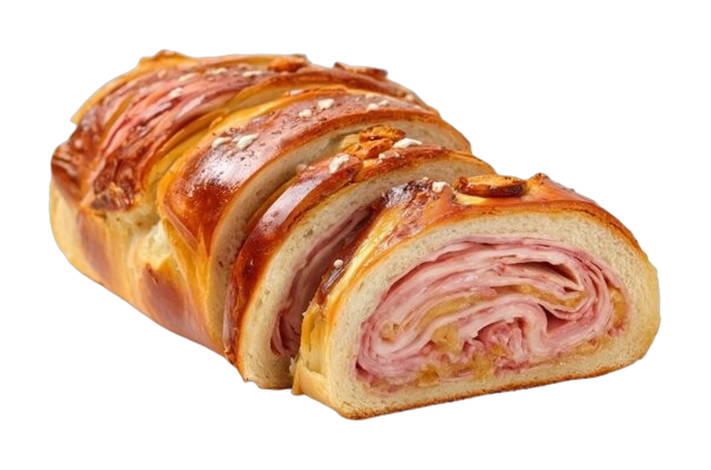
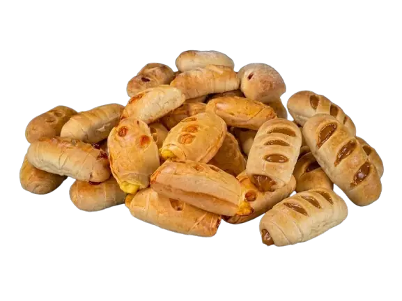
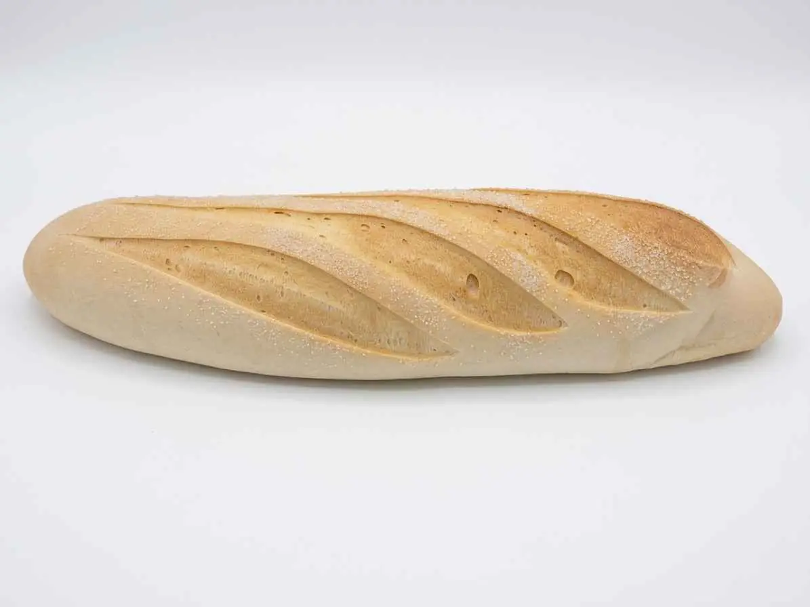
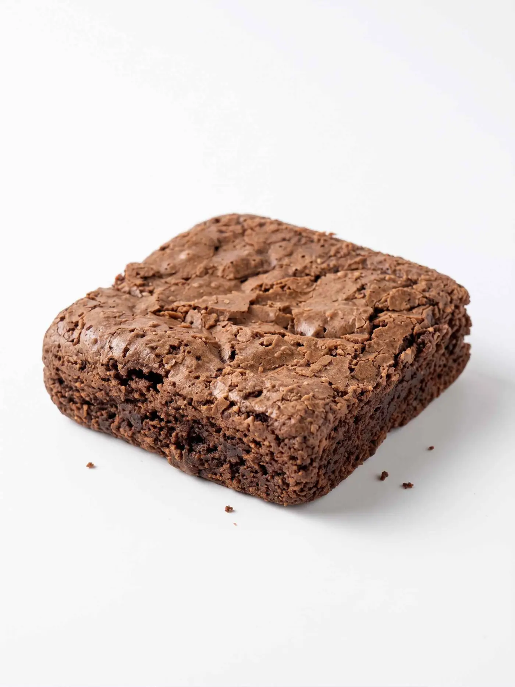

# La Emuna — guía completa del sitio web

Este proyecto es la página web de **Panadería La Emuna** (San Cristóbal, Táchira).
Está hecha solo con **HTML, CSS y JavaScript**, sin frameworks, sin bases de datos y sin servidor propio.

La idea de este README es que, al leerlo, entiendas **cómo funciona cada parte**, qué archivo tocar y qué hace cada trozo de código.

---

## Tabla de contenidos

1. [Cómo abrir el sitio](#1-cómo-abrir-el-sitio)
2. [Estructura de carpetas y archivos](#2-estructura-de-carpetas-y-archivos)
3. [Idea general: cómo se conectan HTML, CSS y JS](#3-idea-general-cómo-se-conectan-html-css-y-js)
4. [Colores y tipografía (`style.css`)](#4-colores-y-tipografía-stylecss)
5. [El menú (todas las páginas)](#5-el-menú-todas-las-páginas)
6. [Inicio (`index.html`)](#6-inicio-indexhtml)
7. [Nosotros (`about.html`)](#7-nosotros-abouthtml)
8. [Productos (`product.html`)](#8-productos-producthtml)
9. [Contacto (`contact.html`)](#9-contacto-contacthtml)
10. [Qué hace `script.js` paso a paso](#10-qué-hace-scriptjs-paso-a-paso)
11. [Diseño responsive (celular vs escritorio)](#11-diseño-responsive-celular-vs-escritorio)
12. [Cómo cambiar cosas comunes](#12-cómo-cambiar-cosas-comunes)
13. [Lista de imágenes y video](#13-lista-de-imágenes-y-video)
14. [Notas finales](#14-notas-finales)

---

## 1. Cómo abrir el sitio

1. Abre la carpeta `emuna` en el explorador de archivos.
2. Da doble clic a `index.html`  
   (o, en VS Code / Cursor, clic derecho → **Open with Live Server**).
3. Si cambias CSS o JS y no se ve el cambio, recarga con **Ctrl + F5** (fuerza a borrar la caché).

No necesitas instalar Node, Python ni nada extra para verlo.

---

## 2. Estructura de carpetas y archivos

```text
emuna/
├── index.html      ← Página de inicio
├── about.html      ← Nosotros
├── product.html    ← Productos
├── contact.html    ← Contacto
├── style.css       ← Todos los estilos (las 4 páginas)
├── script.js       ← Todo el JavaScript (las 4 páginas)
├── README.md       ← Esta guía
├── img/            ← Fotos, logo y favicon (.webp / .ico)
└── videos/         ← Video de la portada (.mp4)
```

| Archivo / carpeta | Para qué sirve |
|-------------------|----------------|
| `index.html` | Portada con video, carrusel, enrolladitos, pan de jamón, fachada |
| `about.html` | Historia, misión y visión + foto del panadero |
| `product.html` | Catálogo con fichas que se voltean al hacer clic |
| `contact.html` | Redes, formulario → WhatsApp, datos y mapa grande |
| `style.css` | Colores, tamaños, menú, carrusel, fichas, móvil, etc. |
| `script.js` | Menú, carrusel, fichas, WhatsApp, video, animaciones |
| `img/` | Solo imágenes |
| `videos/` | Solo el video de fondo de la portada |

Las 4 páginas comparten el **mismo menú**, el **mismo pie**, el mismo `style.css` y el mismo `script.js`.

---

## 3. Idea general: cómo se conectan HTML, CSS y JS

Cada página HTML “llama” a los estilos y al script en el `<head>` y al final del `<body>`:

```html
<head>
    <link rel="icon" href="img/favicon.ico">
    <link rel="stylesheet" href="style.css">
    <!-- Fuentes de Google (Fraunces y Outfit) -->
</head>
<body>
    <!-- ... contenido de la página ... -->

    <script src="script.js"></script>
</body>
```

**Qué significa cada cosa:**

- `style.css` → le dice al navegador **cómo se ve** (colores, tamaños, posición).
- `script.js` → le dice al navegador **qué hacer al hacer clic, al enviar el formulario, al mover el carrusel**, etc.
- El HTML solo **organiza el contenido** (títulos, textos, fotos, botones).

Si borras la línea del CSS, la página se ve “pelada”.  
Si borras la del JS, se ve bien pero **el menú móvil, el carrusel, las fichas y WhatsApp dejan de funcionar**.

---

## 4. Colores y tipografía (`style.css`)

Al inicio de `style.css` están las **variables**. Es como una caja de colores que reutilizamos en todo el sitio:

```css
:root {
    --crema: #efe4d0;
    --crema-oscura: #e6d5bb;
    --marron: #4a2218;
    --texto: #3f2c26;
    --texto-suave: #6e584f;
    --dorado: #e0a82e;
    --dorado-suave: #f3d48a;
    --blanco: #ffffff;
    --titulo: "Fraunces", Georgia, "Times New Roman", serif;
    --texto-fuente: "Outfit", "Segoe UI", sans-serif;
}
```

**Cómo se usan después:**

```css
body {
    background: var(--blanco);
    color: var(--texto);
    font-family: var(--texto-fuente);
}

h1, h2, h3 {
    font-family: var(--titulo);
    color: var(--marron);
}
```

Si cambias `--marron` en `:root`, casi todos los títulos oscuros cambian solos.  
No hace falta buscar color por color en todo el archivo.

| Variable | Uso típico |
|----------|------------|
| `--marron` | Títulos, pie, botones oscuros |
| `--dorado` | Etiquetas, detalles, acentos |
| `--crema` | Fondos de secciones suaves |
| `--titulo` | Fuente de los títulos (Fraunces) |
| `--texto-fuente` | Fuente del texto normal (Outfit) |

Las fuentes se cargan desde Google Fonts en cada HTML. Si no hay internet, el navegador usa **Georgia** y **Segoe UI** (están puestos como respaldo).

---

## 5. El menú (todas las páginas)

### HTML

```html
<header class="menu">
    <div class="contenedor menu-barra">
        <a class="logo" href="index.html">
            
        </a>

        <!-- Solo se ve bien en celular: las 3 rayas -->
        <button class="menu-boton" type="button" aria-label="Abrir menú">
            <span></span><span></span><span></span>
        </button>

        <nav class="nav" aria-label="Principal">
            <ul>
                <li><a href="index.html">Inicio</a></li>
                <li><a href="about.html">Nosotros</a></li>
                <li><a href="product.html">Productos</a></li>
                <li><a href="contact.html">Contacto</a></li>
            </ul>
        </nav>
    </div>
</header>
```

- `.logo` → lleva al inicio.
- `.menu-boton` → en celular abre/cierra el menú.
- `.nav` → lista de enlaces.
- La página actual suele llevar la clase `activo` en su enlace.

### CSS (idea)

- En escritorio el menú flota arriba (`position: absolute`) sobre la portada.
- En celular el botón de 3 rayas se muestra y el menú se abre al ponerle la clase `.abierto`.

### JavaScript (abre / cierra)

```js
var botonMenu = document.querySelector(".menu-boton");
var nav = document.querySelector(".nav");

if (botonMenu && nav) {
    botonMenu.addEventListener("click", function () {
        nav.classList.toggle("abierto");
        botonMenu.classList.toggle("abierto");
    });
}
```

**Explicación línea a línea:**

1. Busca el botón y el menú en la página.
2. `if (botonMenu && nav)` → solo sigue si existen (por si en alguna página faltaran).
3. Al hacer clic, `toggle("abierto")` **pone o quita** la clase.
4. El CSS ya tiene reglas para `.nav.abierto` (mostrar el menú) y para las rayas cuando el botón está `.abierto` (se convierten en una X).

Cuando tocas un enlace del menú, el script también cierra el menú solo, para que no quede abierto encima de la siguiente página.

---

## 6. Inicio (`index.html`)

El inicio se lee de arriba hacia abajo en varias secciones.

### 6.1 Portada (hero) con video

```html
<section class="hero" aria-label="Portada">
    <video autoplay muted loop playsinline preload="auto" class="bg-video">
        <source src="videos/portada-fondo.mp4" type="video/mp4">
    </video>
    <div class="video-overlay"></div>
    <div class="hero-content">
        <h1>Panadería La Emuna</h1>
        <p class="hero-frase">Vendemos pan de jamón y felicidad</p>
        <a href="contact.html" class="boton">Ver ubicaciones</a>
    </div>
</section>
```

| Atributo / clase | Qué hace |
|------------------|----------|
| `autoplay` | Empieza solo |
| `muted` | Sin sonido (los navegadores casi no dejan autoplay con audio) |
| `loop` | Se repite |
| `playsinline` | En el celular no se abre a pantalla completa |
| `.video-overlay` | Capa oscura encima del video para que el texto blanco se lea |
| `.hero-content` | Título, frase y botón encima de todo |

En `script.js` se baja un poco la velocidad del video:

```js
var videoPortada = document.querySelector(".bg-video");
if (videoPortada) {
    videoPortada.playbackRate = 0.75; /* 75% de velocidad normal */
}
```

**Para cambiar el video:** reemplaza `videos/portada-fondo.mp4` (mismo nombre) o cambia el `src` del `<source>`.

### 6.2 Carrusel de productos

Estructura resumida:

```html
<div class="carrusel-marco">
    <button class="carrusel-flecha" data-dir="-1">←</button>
    <button class="carrusel-flecha" data-dir="1">→</button>

    <ul class="carrusel">
        <li class="carrusel-item">
            
            <h3>Pan de jamón</h3>
        </li>
        <!-- más <li class="carrusel-item"> ... -->
    </ul>

    <div class="carrusel-puntos"></div>
</div>
```

- Cada producto es un `<li class="carrusel-item">`.
- `data-dir="-1"` / `"1"` le dice al JS si va hacia atrás o hacia adelante.
- Los **puntos** (`.carrusel-puntos`) los crea `script.js` solo: cuenta cuántas “páginas” de scroll hay y dibuja un botón por cada una.

**Para agregar un producto al carrusel**, copia un bloque así y cambia foto y nombre:

```html
<li class="carrusel-item">
    
    <h3>Nombre del producto</h3>
</li>
```

`loading="lazy"` hace que la imagen se cargue cuando se acerca al área visible (la página arranca más rápido).

### 6.3 Enrolladitos y pan de jamón (círculos de fondo)

Las dos secciones usan la misma idea: una foto **sin fondo** encima de **dos círculos dorados** (uno más claro afuera y uno más fuerte adentro). **No hay animación** en esos círculos.

```html
<div class="foto-enrolladitos">
    <span class="circulo-fondo circulo-fondo-1" aria-hidden="true"></span>
    <span class="circulo-fondo circulo-fondo-2" aria-hidden="true"></span>
    
</div>
```

En CSS:

```css
.circulo-fondo-1 { /* círculo interior, más dorado */
    z-index: 2;
    width: 68%;
    height: 68%;
    background: #e8c15a;
}

.circulo-fondo-2 { /* círculo exterior, más claro */
    z-index: 1;
    width: 90%;
    height: 90%;
    background: #f3e0a8;
}

.foto-enrolladitos img {
    z-index: 3; /* la foto queda encima de los dos círculos */
}
```

`aria-hidden="true"` en los círculos significa: “esto es decoración, los lectores de pantalla pueden ignorarlo”.

La sección de pan de jamón es igual, pero usa `img/PandeJamon.webp` y un poco de CSS extra (`.seccion-pan-jamon`) para poner el texto a la izquierda y la foto a la derecha en escritorio.

### 6.4 Fachada y pie

- La fachada es una sección con foto (`img/fachada.webp`) + texto + botón “Cómo llegar”.
- El **pie** (`<footer class="pie">`) se repite en las 4 páginas: logo, horario, redes e iframe del mapa.

---

## 7. Nosotros (`about.html`)

```html
<section class="seccion pagina nosotros">
    <div class="contenedor">
        <h1>Nosotros</h1>
        <div class="dos-columnas">
            
            <div>
                <p class="etiqueta">Hacia dónde vamos</p>
                <p>Texto de la panadería...</p>
                <h3>Misión</h3>
                <p>...</p>
                <h3>Visión</h3>
                <p>...</p>
            </div>
        </div>
    </div>
</section>
```

- `.dos-columnas` → en escritorio pone foto y texto lado a lado; en celular se apilan.
- `.panadero` → tiene un círculo dorado suave detrás (hecho con CSS `radial-gradient`), no es parte de la foto.

Para cambiar la historia, misión o visión: edita esos párrafos en `about.html`.

---

## 8. Productos (`product.html`)

Los productos están agrupados (por ejemplo “Panadería”, “Antojitos”).  
Cada producto es una **ficha** con cara (foto + nombre) y dorso (descripción).

```html
<article class="ficha" tabindex="0">
    <div class="ficha-giro">
        <div class="ficha-cara">
            
            <h3>Pan azucarado</h3>
        </div>
        <div class="ficha-dorso">
            <h3>Pan azucarado</h3>
            <p>El sabor dulce de compartir en familia.</p>
        </div>
    </div>
</article>
```

### Cómo se voltea (CSS + JS)

El CSS usa `transform: rotateY(180deg)` cuando la ficha tiene la clase `.volteada`.  
El JS solo pone o quita esa clase al hacer clic:

```js
var fichas = document.querySelectorAll(".ficha");

for (var j = 0; j < fichas.length; j++) {
    fichas[j].addEventListener("click", function () {
        this.classList.toggle("volteada");
    });
}
```

**Para agregar un producto:**

1. Copia un `<article class="ficha">...</article>` completo.
2. Cambia la foto (`src`), el nombre (`h3`) y el texto del dorso (`p`).
3. Si quieres, también agrégalo al carrusel de `index.html`.

Algunas imágenes de antojitos usan la clase `sin-fondo` para ajustar un poco el recorte dentro de la ficha:

```html

```

---

## 9. Contacto (`contact.html`)

Tiene tres bloques importantes:

1. Íconos de Instagram, correo y WhatsApp.
2. Formulario (nombre, teléfono, mensaje).
3. Datos de la tienda + mapa grande de Google Maps.

### Formulario (HTML)

```html
<form class="formulario" id="formulario" action="#" method="post">
    <label for="nombre">Nombre</label>
    <input id="nombre" name="nombre" type="text" required>

    <label for="telefono">Teléfono</label>
    <input id="telefono" name="telefono" type="tel" required>

    <label for="detalle">Mensaje</label>
    <textarea id="detalle" name="detalle" rows="4" required></textarea>

    <button class="boton boton-oscuro boton-wa" type="submit">
        Enviar a WhatsApp
    </button>
</form>
```

`required` obliga a llenar el campo antes de enviar.

### Formulario → WhatsApp (JS)

No hay servidor. Al enviar, el script arma un texto y abre WhatsApp:

```js
formulario.addEventListener("submit", function (evento) {
    evento.preventDefault(); /* no recarga la página */

    var nombre = document.getElementById("nombre").value;
    var telefono = document.getElementById("telefono").value;
    var mensaje = document.getElementById("detalle").value;

    var texto =
        "Hola, les escribo desde la página.\n" +
        "Nombre: " + nombre + "\n" +
        "Teléfono: " + telefono + "\n" +
        "Mensaje: " + mensaje;

    var enlace =
        "https://wa.me/+573001059833?text=" +
        encodeURIComponent(texto);

    window.open(enlace, "_blank");
});
```

**Explicación:**

- `preventDefault()` → evita el comportamiento normal del formulario (recargar).
- `.value` → lee lo que escribió la persona.
- `encodeURIComponent` → convierte espacios y acentos para que vayan bien en la URL.
- `wa.me/+57...` → número de WhatsApp (con código de país).
- `window.open(..., "_blank")` → abre WhatsApp en una pestaña nueva.

**Para cambiar el número:** busca `wa.me/` en `contact.html`, en los pies de las otras páginas y en `script.js`.

### Mapa

Es un `<iframe>` de Google Maps. Si quieres otro lugar, entra a Google Maps → Compartir → Insertar un mapa → copia el nuevo `src` del iframe.

---

## 10. Qué hace `script.js` paso a paso

El archivo tiene **6 bloques**. Cada uno empieza con un comentario grande. Si una página no tiene ese elemento (por ejemplo, el carrusel solo está en el inicio), el `if (...)` lo salta y no da error.

### 10.1 Detectar escritorio

```js
function esEscritorio() {
    return window.matchMedia("(min-width: 801px)").matches;
}
```

Devuelve `true` si la ventana tiene **801px o más** de ancho.  
Se usa para:

- animaciones al hacer scroll (solo escritorio);
- un efecto suave del carrusel al moverse.

En celular (800px o menos) esas animaciones se apagan a propósito.

### 10.2 Menú

Ya explicado en la [sección 5](#5-el-menú-todas-las-páginas).

### 10.3 Formulario → WhatsApp

Ya explicado en la [sección 9](#9-contacto-contacthtml).

### 10.4 Carrusel

Ideas clave del código:

```js
function pasoCarrusel() {
    var tarjeta = carrusel.querySelector(".carrusel-item");
    var estilos = window.getComputedStyle(carrusel);
    var espacio = parseFloat(estilos.columnGap) || 0;
    return tarjeta.offsetWidth + espacio;
}
```

Calcula **cuántos píxeles** hay que desplazar: ancho de una tarjeta + el gap entre ellas.

```js
carrusel.scrollBy({ left: direccion * paso, behavior: "smooth" });
```

Mueve el scroll horizontal con animación suave.

También:

- crea los puntos guía;
- marca el punto activo según `scrollLeft`;
- cada **3 segundos** avanza solo;
- si el mouse está encima de la zona, **pausa** el autoplay;
- si la pestaña está oculta (`document.hidden`), también pausa.

### 10.5 Fichas que se voltean

Ya explicado en la [sección 8](#8-productos-producthtml).

### 10.6 Animaciones al bajar (solo escritorio)

Usa `IntersectionObserver`: cuando un elemento **entra en la pantalla**, le pone la clase `.visto` y el CSS hace la animación (subir, crecer, etc.).

```js
if (esEscritorio()) {
    /* ... arma la lista de piezas ... */
    document.documentElement.classList.add("con-scroll");

    var observador = new IntersectionObserver(function (entradas) {
        for (var e = 0; e < entradas.length; e++) {
            if (entradas[e].isIntersecting) {
                entradas[e].target.classList.add("visto");
                observador.unobserve(entradas[e].target);
            }
        }
    }, { threshold: 0.15 });

    /* observa cada pieza */
}
```

- `threshold: 0.15` → cuando se ve un 15% del elemento, dispara.
- `unobserve` → anima una sola vez (no se repite cada vez que subes y bajas).
- En CSS, las clases `.entra`, `.m-sube`, `.m-crece`, etc. definen el movimiento; `.visto` completa la animación.

---

## 11. Diseño responsive (celular vs escritorio)

En `style.css` hay un bloque grande:

```css
@media (max-width: 800px) {
    /* reglas solo para celular */
}
```

Ahí se ajustan, entre otras cosas:

- el menú hamburguesa;
- las columnas (pasan de 2 a 1);
- tamaños de título y de fotos;
- menos padding en las secciones de enrolladitos / pan de jamón.

Regla práctica del proyecto:

| Ancho | Comportamiento |
|-------|----------------|
| ≤ 800px | Celular: menú de rayas, 1 columna, sin animaciones de scroll |
| ≥ 801px | Escritorio: menú horizontal, 2 columnas, animaciones al bajar |

---

## 12. Cómo cambiar cosas comunes

### Cambiar un texto

Abre el `.html` correspondiente, busca el párrafo o título y edítalo. Guarda y recarga.

### Cambiar una foto

1. Pon la imagen nueva en `img/` (mejor formato `.webp`).
2. En el HTML, cambia el `src`:

```html

```

### Cambiar el video de portada

1. Pon el archivo en `videos/`.
2. Usa el mismo nombre `portada-fondo.mp4`, **o** cambia el `src` en `index.html`:

```html
<source src="videos/portada-fondo.mp4" type="video/mp4">
```

### Cambiar colores

Edita las variables en `:root` dentro de `style.css` (ver [sección 4](#4-colores-y-tipografía-stylecss)).

### Cambiar WhatsApp

Busca esta parte (aparece varias veces):

```text
https://wa.me/+573001059833
```

Cámbiala por tu número con código de país, sin espacios ni guiones raros.  
Archivos donde suele estar: `script.js`, `contact.html` y los pies de las otras páginas.

### Agregar producto (resumen)

1. Copia una ficha en `product.html`.
2. (Opcional) Copia un `carrusel-item` en `index.html`.
3. Pon la foto en `img/`.

---

## 13. Lista de imágenes y video

### Carpeta `videos/`

| Archivo | Uso |
|---------|-----|
| `portada-fondo.mp4` | Fondo de la portada del inicio |

### Carpeta `img/`

| Archivo | Uso |
|---------|-----|
| `logo.webp` | Logo del menú y del pie |
| `favicon.ico` | Ícono de la pestaña del navegador |
| `mano_obra.webp` | Sección de trabajo artesanal (inicio) |
| `enrolladitos.webp` | Sección enrolladitos (inicio) |
| `PandeJamon.webp` | Sección pan de jamón + carrusel |
| `fachada.webp` | Foto del local (inicio) |
| `model1.webp` | Panadero (Nosotros) |
| `PanAzucarado.webp`, `Pandeleche.webp`, `Pandemantequilla.webp`, ... | Carrusel e inicio / fichas de productos |
| `brownie.webp`, galletas, `Turron_blanco.webp`, etc. | Antojitos en productos y carrusel |

Si un archivo **no aparece en ningún HTML**, no se está usando y se puede borrar.

---

## 14. Notas finales

- Es un sitio **estático**: no guarda datos en ningún servidor.
- El formulario **no envía correo**; abre WhatsApp con el mensaje listo.
- Las fotos van en **WebP** para que pesen menos y carguen más rápido.
- El video va en **`videos/`**, no en `img/`, porque no es una imagen.
- Los comentarios dentro de los archivos están en español a propósito, para que un estudiante pueda leer el código y entenderlo.

Si algo “desaparece” después de editar:

1. Revisa que no falte una etiqueta de cierre (`</div>`, `</section>`, `</p>`).
2. Mira la consola del navegador (F12 → Consola) por si hay un error de JavaScript.
3. Recarga con **Ctrl + F5**.

Con eso deberías poder entender y modificar cada parte del sitio con seguridad.
